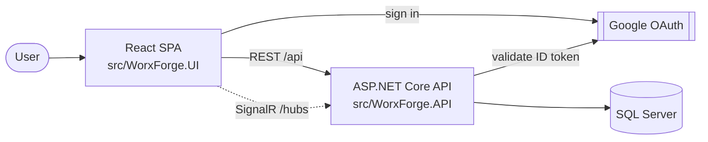

# WorxForge

WorxForge is an enterprise platform for creating, sharing, discovering, and reusing **AI knowledge assets** — prompts, agents, workflows, and coding standards — across teams. This repository is the **unified monorepo** containing both the backend API and the web frontend.


## Overview

Teams use WorxForge to publish reusable AI assets, discover and search what others have shared, build a personal library, and collaborate through comments, reactions, and real-time notifications. It is an internal, authenticated application: users sign in with Google, and all functionality sits behind a JWT-secured REST API.

The system has two parts, developed together in this monorepo:

| Part | Location | Stack |
|---|---|---|
| **Backend API** | [`src/`](src/) | ASP.NET Core 10, EF Core 10, SQL Server, SignalR, Google OAuth + JWT |
| **Frontend (Web)** | [`src/WorxForge.UI/`](src/WorxForge.UI/) | React 19 + TypeScript, Vite 8, Tailwind CSS v4, TanStack Query |

The frontend calls the backend through a generated, typed API client; in local development a Vite proxy forwards `/api/*` to the running API, and SignalR delivers notifications over a WebSocket connection.

## Key Capabilities

- **Authentication & profiles** — Google sign-in; personal and public user profiles
- **Asset publishing** — create, edit, and soft-delete assets (prompts, agents, workflows, standards)
- **Explore & search** — filter by domain, type, and tool, with pagination
- **Personal library** — bookmark and organize saved assets
- **Comments & reactions** — threaded comments and reactions on assets
- **Real-time notifications** — delivered via SignalR
- **Reporting** — report assets and comments for review
- **Admin moderation** — manage assets, comments, reports, and users

## Architecture



### Backend

A layered ASP.NET Core solution ([`src/WorxForge.slnx`](src/WorxForge.slnx)). Project dependencies point **inward** toward a dependency-free Domain; abstractions declared in `Core` are implemented in `Infrastructure`.

| Project | Responsibility | Depends on |
|---|---|---|
| `WorxForge.Domain` | Entities, commands, queries, DTOs, enums, errors | *(none)* |
| `WorxForge.Core` | Command/query handlers, validators, service & repository interfaces | Domain |
| `WorxForge.Infrastructure` | EF Core `DbContext`, repositories, AutoMapper profiles, external services, migrations, seeding | Core, Domain |
| `WorxForge.API` | Minimal-API endpoint groups, middleware, SignalR hubs, auth, Swagger | Core, Infrastructure, Domain |

Cross-cutting concerns: Serilog (logging), a global exception handler emitting RFC 7807 `ProblemDetails`, JWT bearer auth with role-based authorization, and lookup-data seeding on startup.

### Frontend

A feature-based React application under [`src/WorxForge.UI/src/`](src/WorxForge.UI/src/):

- `features/<domain>/` — components, hooks, models, pages, and services per domain (assets, auth, explore, home, library, comments, notifications, profile, reports, admin)
- `api/` — NSwag-generated typed client plus a custom fetch wrapper
- `contexts/` — `AuthContext`, `SessionContext`, `NotificationContext`
- `layouts/`, `routes/`, `navigation/`, `components/`, `lib/`, `utils/` — shells, routing, shared UI and helpers

Server state is managed with **TanStack Query**; forms use **React Hook Form + Zod**; routing uses **React Router v7**.

## Repository Structure

```text
WorxForge/
├── src/
│   ├── WorxForge.API/            # Minimal-API endpoints, middleware, SignalR hubs, Swagger
│   ├── WorxForge.Core/           # Handlers, validators, interfaces/abstractions
│   ├── WorxForge.Domain/         # Entities, commands, queries, DTOs, errors
│   ├── WorxForge.Infrastructure/ # EF Core, repositories, mapping, migrations, seeding
│   ├── WorxForge.UI/             # React + Vite frontend
│   ├── Tests/                    # Unit / Integration / System tests
│   └── WorxForge.slnx            # Solution
├── .config/dotnet-tools.json     # Local .NET tools (NSwag)
├── docs/                         # Requirements, DB schema, and history docs
├── Directory.Build.props         # Shared MSBuild properties
├── Directory.Packages.props      # Central NuGet package management
├── global.json                   # Pinned .NET SDK
├── .nvmrc                        # Pinned Node.js version
├── .editorconfig                 # Shared editor config (backend + frontend scoped)
├── setup.ps1 / setup.sh          # Unified setup (backend + frontend)
└── README.md
```

## Technology Stack

| Area | Technology |
|---|---|
| Backend runtime | .NET 10 (`net10.0`), ASP.NET Core 10 (minimal APIs) |
| Database | SQL Server |
| ORM | Entity Framework Core 10 (code-first migrations + seeding) |
| Mapping | AutoMapper |
| Authentication | Google OAuth 2.0 (ID-token validation) + JWT bearer; role-based authorization |
| Real-time | SignalR (+ background delivery service) |
| Logging | Serilog (console sink) |
| API docs | Swashbuckle (Swagger UI) + ASP.NET Core OpenAPI |
| Backend tests | xUnit, FluentAssertions, Moq, coverlet |
| Frontend | React 19, TypeScript, Vite 8 |
| Styling | Tailwind CSS v4 |
| Server state / data | TanStack Query v5 |
| Forms / validation | React Hook Form + Zod |
| Routing | React Router v7 |
| API client | NSwag-generated TypeScript client |
| Frontend tests | Vitest + Testing Library (jsdom) |
| Lint | oxlint |
| Package mgmt | npm (frontend), central NuGet management (backend) |

## Prerequisites

### Required

- **.NET SDK** — version pinned by [`global.json`](global.json) (`10.0.3xx`)
- **Node.js 24** and **npm** — version pinned by [`.nvmrc`](.nvmrc)
- **SQL Server** — any edition (Express, Developer, LocalDB, or Azure SQL)
- **Git**
- **PowerShell 5.1+** *(Windows)* or **Bash** *(macOS / Linux)* — for the setup scripts

### Optional

- **Google Cloud OAuth 2.0 Client ID** — only needed for real Google sign-in; the development `debug-login` endpoint works without it
- Docker is **not** required (no containerization in this repository)

## Quick Start

Run the unified setup script from the repository root. It sets up both the backend and the frontend by default.

**Windows (PowerShell)**

```powershell
.\setup.ps1                # backend + frontend
.\setup.ps1 -BackendOnly   # backend only
.\setup.ps1 -FrontendOnly  # frontend only
```

**macOS / Linux (Bash)**

```bash
chmod +x setup.sh
./setup.sh                 # backend + frontend
./setup.sh --backend-only
./setup.sh --frontend-only
```

The script restores tools and packages, builds, prompts for backend secrets, offers to apply database migrations, and installs frontend dependencies. For CI/non-interactive use, pass `-NonInteractive` (PowerShell) or `--non-interactive` (Bash).

## Backend Development

### Configuration (User Secrets)

Backend configuration uses [ASP.NET Core User Secrets](https://learn.microsoft.com/en-us/aspnet/core/security/app-secrets) so no credentials are committed. The setup script prompts for these; to set one manually:

```powershell
dotnet user-secrets set "<Key>" "<Value>" --project src/WorxForge.API
```

**Required**

| Key | Description |
|---|---|
| `ConnectionStrings:DefaultConnection` | SQL Server connection string |
| `Cors:AllowedOrigins:0` | Frontend origin allowed by CORS (no trailing slash); the API refuses to start if missing |

**Optional** (development defaults in `appsettings.Development.json` work out of the box): `Authentication:Google:ClientId`, `JwtAccessToken:*`, and the `debug-login` development user keys.

### Database

EF Core code-first migrations manage the schema (the setup script offers to apply them). To apply manually:

```powershell
dotnet ef database update `
  --project src/WorxForge.Infrastructure `
  --startup-project src/WorxForge.API `
  --context WorxForge.Infrastructure.Configuration.WorxForgeDbContext
```

`dotnet ef` and NSwag are restored via `dotnet tool restore` (run by setup).

### Running the API

```powershell
cd src/WorxForge.API
dotnet run
```

- API: `https://localhost:7235` and `http://localhost:5222`
- Swagger UI (Development only): `https://localhost:7235/swagger`

**Debug login (Development only):** `POST /api/authentication/debug-login` issues a JWT for backend-only work without a real Google token.

## Frontend Development

Environment variables live in `src/WorxForge.UI/.env.local` (git-ignored). Copy [`src/WorxForge.UI/.env.example`](src/WorxForge.UI/.env.example) to begin.

| Variable | Description | Required |
|---|---|---|
| `VITE_API_BASE_URL` | Runtime backend base URL; leave empty locally to use the Vite proxy | No |
| `VITE_API_PROXY_TARGET` | Vite dev-proxy target for `/api` (and SignalR hub base) | Yes (local dev) |
| `VITE_GOOGLE_CLIENT_ID` | Google OAuth 2.0 Client ID | Yes |

```bash
cd src/WorxForge.UI
npm ci
npm run dev          # dev server at http://localhost:5173
npm run build        # production build (tsc -b && vite build) -> dist/
npm run lint         # oxlint
npm test             # vitest
```

## Connecting Frontend and Backend

For local development, point the proxy at the running backend:

```env
# src/WorxForge.UI/.env.local
VITE_API_PROXY_TARGET=https://localhost:7235
```

Vite forwards `/api/*` to that URL, so no CORS setup is needed locally. Start the backend, then the frontend.

The typed API client (`src/WorxForge.UI/src/api/worxforgeClient.ts`) is generated from the backend's OpenAPI document via NSwag using `src/WorxForge.UI/generate-api.ps1` (starts the API, then runs `nswag`).

## Testing & Quality

**Backend**

```powershell
dotnet test src/WorxForge.slnx
```

Unit, Integration, and System test tiers live under `src/Tests/`. Integration/System tests expect a reachable SQL Server.

**Frontend**

```bash
cd src/WorxForge.UI
npm run build     # includes typecheck (tsc -b)
npm run lint      # oxlint
npm test          # vitest
```

> On some environments (deep paths / limited resources) Vitest's parallel workers can time out spawning; if that happens, run `npm test -- --maxWorkers=1`.

Quality tooling: `oxlint` (frontend), shared `.editorconfig`, and central NuGet package management. Static-analysis services (SonarQube, CodeQL, Dependabot) are not currently configured.

## CI/CD

- **Backend CI** (`.github/workflows/backend-ci.yml`) restores, builds, and tests the .NET solution for relevant pull requests and pushes to `main`.
- **Frontend CI** (`.github/workflows/frontend-ci.yml`) performs a clean npm install, high-severity dependency audit, lint, tests, and a production build for relevant pull requests and pushes to `main`.
- **Release** (`.github/workflows/release.yml`) is a manual, `main`-only workflow. It validates a `v`-prefixed SemVer version, rejects existing tags/releases, revalidates both stacks, creates an annotated tag without force, and publishes a GitHub Release with generated notes.

Run a future release from `main` with:

```bash
gh workflow run release.yml --ref main -f version=v1.1.0
```

GitHub Pages is intentionally not configured or published. Pages remains deferred while this private repository's current organization plan does not support it; static landing-page source can be added later without enabling publication.

## Development Workflow

1. Pull the latest `main`.
2. Create a `feature/…`, `fix/…`, or `hotfix/…` branch.
3. Implement the change.
4. Run the relevant local checks (build, tests, lint/typecheck).
5. Push the branch and open a pull request into `main`.
6. Review and address feedback.
7. Merge with a merge commit.

Commit messages follow [Conventional Commits](https://www.conventionalcommits.org/) (`feat:`, `fix:`, `chore:`, `refactor:`, …).

## Branch Naming

```text
feature/<short-description>
fix/<short-description>
hotfix/<short-description>
```

> **`legacy-fe/*`** branches are **retained historical references** from the frontend-repository consolidation and preserve pre-squash frontend commits. They are **not** active development branches — do not base new work on them.

## Where Do I Find…?

| Looking for | Location |
|---|---|
| Backend API endpoints | `src/WorxForge.API/EndpointGroups/` |
| Real-time hubs | `src/WorxForge.API/Hubs/` |
| Domain entities & DTOs | `src/WorxForge.Domain/` |
| Handlers & validators | `src/WorxForge.Core/` |
| EF Core, repositories, mapping | `src/WorxForge.Infrastructure/` |
| Database migrations | `src/WorxForge.Infrastructure/Migrations/` |
| Frontend pages & features | `src/WorxForge.UI/src/features/` |
| Generated API client | `src/WorxForge.UI/src/api/` |
| Backend tests | `src/Tests/` |
| Requirements & schema docs | `docs/` |
| Setup scripts | `setup.ps1`, `setup.sh` |

## Documentation

- [Business Requirements (BRD)](docs/WorxForge___BRD.pdf)
- [Software Requirements (SRS)](<docs/WorxForge srs.pdf>)
- [Database Schema](docs/WorxForge_db_schema.pdf)
- [Presentation](docs/Presentation.pdf)
- [Repository consolidation (monorepo history)](docs/repository-consolidation.md)
- Component READMEs: [Backend](src/README.md) · [Frontend](src/WorxForge.UI/README.md)

## Repository Note

WorxForge is maintained as a single monorepo containing both the frontend and backend. It was created by consolidating the former `WorxForge-FE` and `WorxForge-BE` repositories with their full Git history preserved; historical frontend repository activity is retained separately for audit purposes.

## Contributors

- Aliaa Eissa — https://www.linkedin.com/in/alyaaeissa2005/
- Aya Sherif — https://www.linkedin.com/in/aya-sherif-56721b326/
- Amr Atif — https://www.linkedin.com/in/amr-atif-68b121363/
- Mahmoud Tarek — https://www.linkedin.com/in/mahmoud-tarek-5549a2375/
